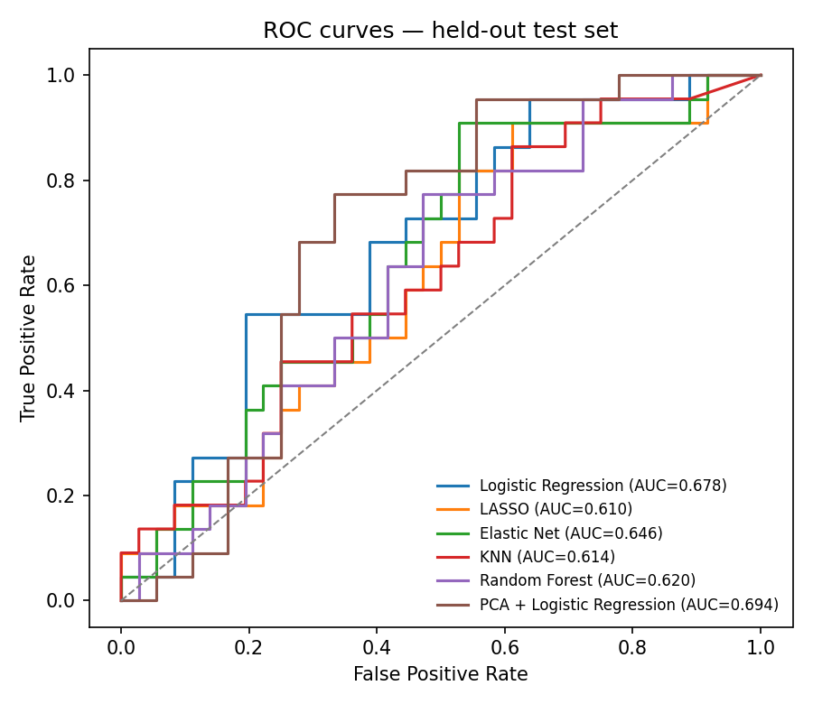
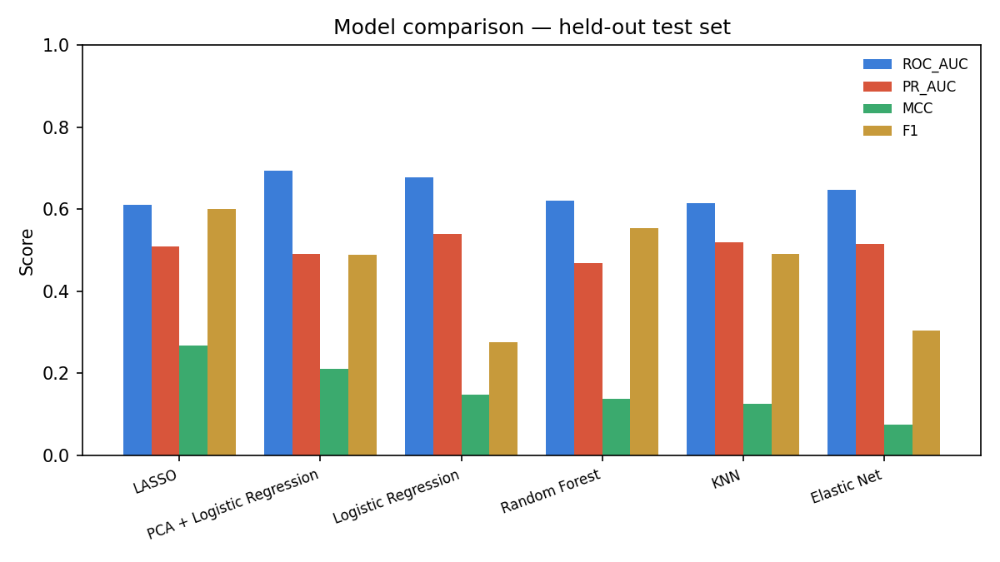
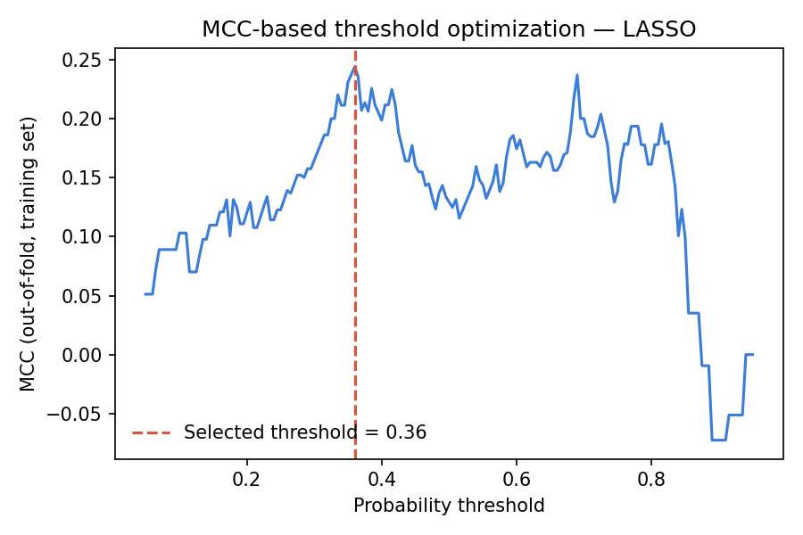
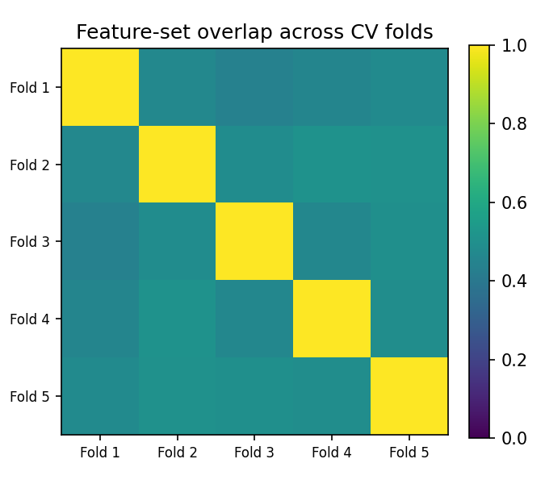

# Machine Learning for Gene Expression-Based Phenotype Classification

A leakage-controlled machine-learning pipeline for high-dimensional gene-expression data. It compares Logistic Regression, LASSO, Elastic Net, KNN, Random Forest and PCA + Logistic Regression, using stratified cross-validation and MCC-based threshold optimization, and evaluates performance across clinical subgroups.

The reference application is breast-cancer relapse prediction on NCBI GEO [GSE2034](https://www.ncbi.nlm.nih.gov/geo/query/acc.cgi?acc=GSE2034) (Wang et al., *Lancet* 2005). The pipeline itself is dataset-agnostic: it runs on **any GEO series** (downloaded automatically with GEOparse) or **your own expression and clinical files**.

📄 **Full report:** [`report/Gene_Expression_Classification_Report.pdf`](report/Gene_Expression_Classification_Report.pdf)
📓 **Notebook (Colab-ready):** [`notebooks/gene_expression_classification.ipynb`](notebooks/gene_expression_classification.ipynb)

## Research questions

- Can gene-expression profiles predict relapse?
- Which genes contribute most to the prediction?
- How do Logistic Regression, LASSO, Elastic Net, KNN and Random Forest compare?
- Does threshold optimization improve MCC?
- Does performance stay stable across clinically relevant subgroups (ER status)?

## Results on GSE2034

286 lymph-node-negative patients (179 no relapse, 107 relapse) and 22,215 Affymetrix HG-U133A probes. Stratified 228 / 58 train/test split, 5-fold CV, seed 42. Results on the held-out test set:

| Model | ROC-AUC | PR-AUC | MCC | Sensitivity | Specificity | F1 | Threshold |
|---|---|---|---|---|---|---|---|
| **LASSO** | 0.610 | 0.509 | **0.268** | 0.818 | 0.444 | 0.600 | 0.36 |
| PCA + Logistic Regression | 0.694 | 0.490 | 0.211 | 0.455 | 0.750 | 0.488 | 0.63 |
| Logistic Regression | 0.678 | 0.540 | 0.147 | 0.182 | 0.917 | 0.276 | 0.88 |
| Random Forest | 0.620 | 0.469 | 0.137 | 0.818 | 0.306 | 0.554 | 0.25 |
| KNN | 0.614 | 0.520 | 0.125 | 0.545 | 0.583 | 0.490 | 0.28 |
| Elastic Net | 0.646 | 0.515 | 0.075 | 0.227 | 0.833 | 0.303 | 0.72 |

**ER subgroups (LASSO, test set):** for ER+ (n = 41), MCC 0.380 and ROC-AUC 0.720. For ER− (n = 17), MCC 0.070 and ROC-AUC 0.431.

The signal is modest but above chance. This is consistent with the known difficulty of single-cohort prognostic signatures when p ≫ n, and the report discusses it in detail.

| | |
|---|---|
|  |  |
|  |  |

## Method

```
GEO / CSV → expression + phenotype → QC → stratified train/test split
  → [ impute → ANOVA feature selection → scaling → (PCA) → model ]  ← refit inside every CV fold
  → out-of-fold probabilities → MCC-optimal threshold (training set only)
  → single evaluation on the untouched test set → subgroup analysis → top features
```

- **Leakage control.** Imputation, feature selection (`SelectKBest`, k = 1000), scaling and PCA are steps inside a scikit-learn `Pipeline`, so they are refit on the training fold only. A diagnostic measures how much the selected gene sets overlap across folds (0.48 on GSE2034), which shows the selection really is refit each time.
- **Threshold optimization.** The decision threshold is chosen to maximize MCC on out-of-fold training predictions, then locked and applied once to the test set.
- **Metrics.** ROC-AUC, PR-AUC, MCC, sensitivity, specificity, precision, F1, accuracy and confusion matrices.
- **Subgroup analysis.** Uses any clinical column you choose, evaluated on the test set at the locked threshold.

## Quick start

```bash
pip install -r requirements.txt

# 1. Reproduce the report (GSE2034, data included in data/)
python src/pipeline.py --config configs/gse2034.json

# 2. Any GEO series: list its clinical columns, then choose a target
python src/pipeline.py --geo GSE7390 --list-columns
python src/pipeline.py --geo GSE7390 --target e.dmfs --positive 1 --subgroup er

# 3. Your own files (samples as columns, like GEO; set samples_in_columns=false otherwise)
python src/pipeline.py --expression my_expression.csv --clinical my_clinical.csv \
                       --target status --positive relapse --subgroup ER
```

Or open the notebook in Google Colab; its first cell clones this repository.

Each run writes to `results/<name>/`:
- `model_comparison.csv`, `subgroup_analysis.csv`, `top_selected_features.csv` (with gene symbols when GEO annotation is available) and `summary.json`
- `best_model.joblib`
- every figure in `figures/`

### Config files

Instead of command-line flags, describe a dataset in `configs/<name>.json`. Only the data location and target are required; everything else has defaults (see [`src/config.py`](src/config.py)).

```json
{
  "name": "GSE7390",
  "source": "geo",
  "geo_id": "GSE7390",
  "target_column": "e.dmfs",
  "positive_label": 1,
  "class_names": ["No distant metastasis", "Distant metastasis"],
  "subgroup_column": "er"
}
```

What the pipeline handles automatically:
- **Target:** text or numeric labels. Matching is case-insensitive, and samples with a missing label are dropped. `negative_label` restricts the run to two classes when a column has more.
- **Scale:** log2 is applied automatically when values look like raw intensities (max > 100).
- **Missing values:** features missing in more than 20% of samples are dropped; the rest are imputed with the median inside each fold.
- **Small datasets:** the number of selected features, PCA components and KNN neighbours are capped to fit the data.

## Repository structure

```
├── configs/
│   ├── gse2034.json             # reference run (report)
│   └── gse7390_example.json     # second breast-cancer cohort, downloaded from GEO
├── data/
│   ├── GSE2034.csv.gz           # 286 × 22,215 expression matrix (MAS5, log2)
│   └── clinical.tsv             # relapse, ER status, follow-up time, ...
├── src/
│   ├── pipeline.py              # entry point (CLI)
│   ├── config.py                # run configuration
│   ├── data.py                  # loading (local / GEO), target, QC
│   ├── models.py                # the six leakage-safe pipelines
│   ├── evaluation.py            # metrics, MCC threshold, stability check
│   └── plots.py                 # figures
├── notebooks/                   # Colab-ready notebook
├── results/GSE2034/             # tables and figures from the reference run
└── report/                      # full project report (PDF)
```

## Data sources

- **GSE2034 expression matrix:** MAS5-normalized, log2. Taken from the GEO series via the public [EpistasisLab/breast-cancer-collection](https://github.com/EpistasisLab/breast-cancer-collection) mirror.
- **GSE2034 clinical table:** from the NCBI GEO accession viewer. All 286 samples match the expression matrix one-to-one.
- **Other GEO series:** downloaded with GEOparse. Clinical columns come from each sample's `characteristics` fields, and gene symbols from the platform annotation.

## Limitations

- **Single cohort and a single 80/20 hold-out:** small sample size relative to the number of features (p ≫ n).
- **Unstable feature selection:** about 48% overlap across folds, so individual probes should not be read as a validated biomarker panel.
- **No hyperparameter tuning:** nested CV is future work.
- **Subgroups limited to available clinical variables:** GSE2034 has no sex or ethnicity data, so subgroup analysis uses ER status rather than claiming a demographic fairness assessment.

**Future work:** external validation on an independent cohort (e.g. GSE7390, already supported), pathway enrichment of selected genes, SHAP for tree models, and survival analysis.

## Author

Mohamed Ben Othman
